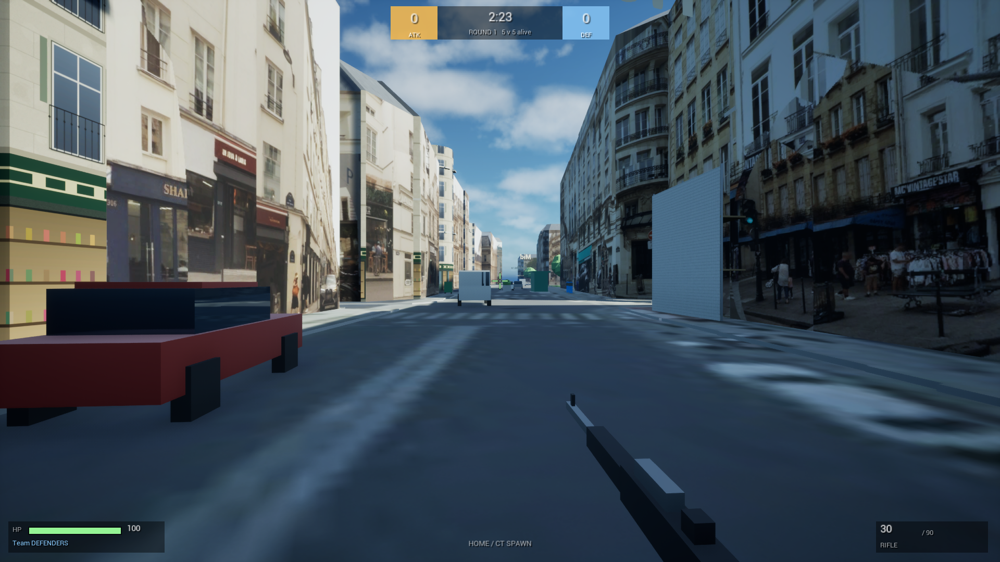

# Paris Saint-Martin — 5v5 bomb-defusal FPS map (Unreal Engine 5.8)

A Counter-Strike-style bomb map of the real streets around **347 Rue Saint-Martin, 75003 Paris**,
generated from open data — OpenStreetMap footprints, IGN measured building heights and the City of
Paris street-level photo survey (Panoramax) projected onto the facades — and assembled into an
Unreal Engine 5.8 project.
Defenders spawn at your front door; attackers come up from Rue Réaumur / Arts-et-Métiers.
Site A is on Rue Notre-Dame-de-Nazareth at the Passage du Vertbois, site B is Square Émile-Chautemps.

See `architecture.md` for how it is built and `feature.md` for what is implemented.

## Requirements

* Windows, Unreal Engine 5.8 installed at `D:\UE_5.8` (change `-Engine` in `tools/ue/*.ps1` otherwise)
* Visual Studio 2022 Build Tools with the C++ workload (MSVC 14.4x) — needed once to compile the game module
* Python 3 on PATH, with **Pillow** and **numpy** for the real-facade step
  (`pip install --target "<python>\Lib\site-packages" pillow numpy` — the tools run with `python -I`,
  which ignores the per-user site-packages)
* Internet access for the data downloads (OpenStreetMap, IGN, Panoramax); about 1 GB of street photos
  is cached under `data/raw/panoramax/img/` (flagged Dropbox-ignored)

## Build everything

```powershell
powershell -ExecutionPolicy Bypass -File tools\ue\build_all.ps1
```

That runs, in order:

1. `tools/make_textures.py` – procedural PNG textures → `assets/textures/`; `tools/make_sounds.py` –
   synthesised sound effects (guns, grenades, shop) → `assets/sounds/`; `tools/fetch_ortho.py` – the IGN aerial orthophoto for the
   **real ground** → `assets/ortho/` (first run only, or with `-FetchData`)
2. `tools/import_blender_assets.py` – (optional, needs Blender) exports the user-supplied Parisian building pack into
   `assets/models/parisian_block/` (the exported pieces are committed, so this only runs when the pack changes)
3. `tools/build_facades.py` – the **real facades**: re-projects the City of Paris street photos
   (Panoramax) onto every street-facing wall → `assets/facades/*.jpg` (≈ 15 min, downloads ≈ 1 GB of
   photos the first time; `-SkipFacades` keeps the existing atlases)
4. `tools/build_map.py` – OSM + IGN heights + facade atlases + war-zone layer → `data/map/meshes/*.obj` +
   `data/map/level.json` (+ `data/preview_level.png`)
5. `tools/ue/build_project.ps1` – compiles the C++ modules with UnrealBuildTool
6. `tools/ue/build_level.ps1` – runs `Scripts/build_level.py` inside `UnrealEditor-Cmd` to import the
   textures, meshes and FBX models (only the ones whose source file is newer than the asset), create materials,
   assemble and save `/Game/Maps/L_SaintMartin`, and build the nav mesh
   (first run ≈ 16 min of mesh import + 14 min of nav-mesh generation; add `-SkipNav` to skip the
   bake — bots then use the runtime-generated nav mesh)

Add `-FetchData` to re-download the OpenStreetMap data, the IGN buildings and the photo index first.

## Play



*Rue Saint-Martin from the defenders' spawn: every wall is the real facade, projected from the City of Paris
street-photo survey, and the ground is the IGN aerial orthophoto (`data/screenshot_soldier.png` shows a
teammate; the earlier procedural look is kept in `data/screenshot_ingame.png`).*

**Quickest:** double-click `Play.bat` at the root of the workspace. It launches the game directly
(`UnrealEditor.exe … -game`, windowed 1920×1080, no editor UI). Options via PowerShell:

```powershell
powershell -ExecutionPolicy Bypass -File tools\ue\play.ps1 -Fullscreen          # or -Width 2560 -Height 1440
```

You join as a Defender at the front door with 4 bot teammates against 5 bot attackers. Quit with Alt+F4.

**From the editor:** double-clicking `unreal\ParisBombMap\ParisBombMap.uproject` opens the **Unreal Editor** (that is
what a .uproject always does — it does not start the game). The level `L_SaintMartin` loads automatically; press
**Play** in the toolbar (Alt+P) to play inside the viewport, or use the Play dropdown → *Standalone Game* for a
separate window. Esc stops the session.

| Key | Action |
|---|---|
| W A S D / mouse | move / look (you run by default) |
| Shift | walk (slow, quiet, accurate) |
| Ctrl | crouch |
| Space | jump |
| Left mouse | fire (one click = one shot on semi-automatic guns) |
| Right mouse | zoom with the SR-30 / LR-50; under-hand lob with a grenade out |
| R | reload |
| 1 / 2 / 3 | main gun / sidearm / knife (you run faster with the knife) |
| 4 (hold) | take the bomb out and plant it inside A / B (attacker); defuse next to it (defender) |
| Q / E / C | flashbang / smoke / frag out, then left click to throw |
| 5 | cycle the grenades you carry |
| F | pick up (or swap for) a dropped gun |
| B | buy menu, during the buy phase (left click buys, right click sells back) |
| Tab | scoreboard |
| M | switch team at the next round |

Rules (ported from [FPS Reborn](../fps-reborn), rules only): 20 s buy phase (5 s in round 1) where you can walk
inside your spawn and shop, 100 s round, 45 s bomb timer, 4 s plant, 7 s defuse, 10 m blast. Money: start $800, round
win $3 000, loss $1 900 / $2 400 / $2 900 by losing streak, $200 per kill, $300 to every attacker on a plant, cap $9 000;
survivors keep their guns, the dead restart with the P9. First to 13, win by two, sides swap after round 12 and every round
in overtime; halftime resets money and loadouts. Eleven guns (5 sidearms, 4 main guns, 2 snipers) + knife, kevlar
(+25 / +50), smoke / flashbang / frag grenades, dropped guns can be picked up. As an attacker the bomb waits on the ground
next to you at round start; your bot teammates only take it 10 s after GO, if you leave spawn without it, or if you die.

## Changing the map

* Edit `data/map/layout.json` (zone, spawns, sites, cut-offs, covered passages, callouts, props, and the `warzone`
  section: model pieces, dressing props, lighting mood), then run
  `python -I tools\build_map.py` and `tools\ue\build_level.ps1 -ForceReimport`.
  `data/preview_level.png` shows the result top-down before touching Unreal.
* Gameplay tuning lives in `unreal/ParisBombMap/Source/ParisBombMap/BombGameMode.h` (times, team size) and
  `FPSCharacter.h` (weapon, speeds).

## Layout

```
data/        raw OSM download, layout.json (design), generated level.json + meshes, previews
assets/      generated textures
tools/       Python pipeline + PowerShell build wrappers (tools/ue)
unreal/      the UE 5.8 project (C++ source, config, editor build script; Content/ is generated)
```
